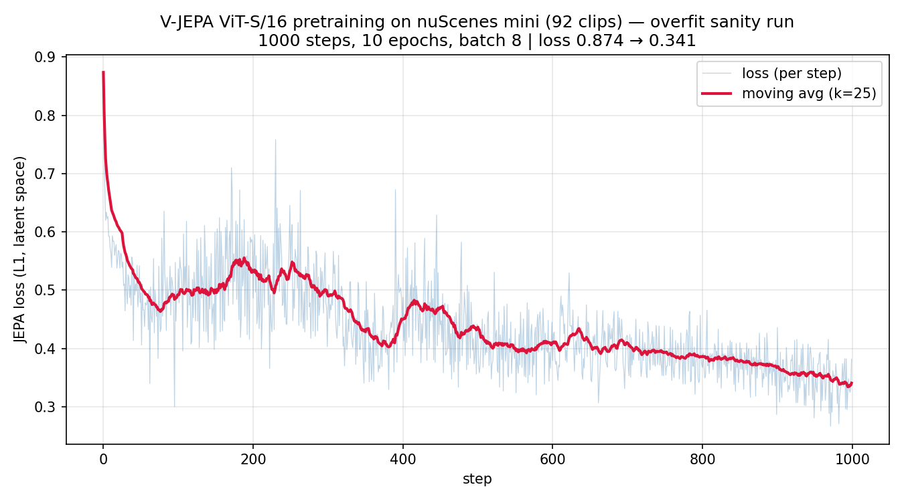

# V-JEPA × nuScenes：数据与训练管线

[English](README.md)

在单张 12GB GPU 上，用官方 [V-JEPA](https://github.com/facebookresearch/jepa) 代码对 nuScenes 前视相机视频做自监督预训练的数据与训练管线。

> **当前状态**：管线已在 nuScenes mini 上跑通，计划中的四组对照实验尚未开始。本仓库目前只能说明「数据处理 → 训练」整条链路可以运行，不对表征质量作任何结论。

## 内容

| 路径 | 说明 |
|---|---|
| `scripts/preprocess_clips.py` | nuScenes mini 的 CAM_FRONT 帧（关键帧 + sweeps，12Hz）按 `prev/next` 链排序，每 24 帧（2 秒）编码为一个 h264 片段，并生成 V-JEPA 所需的 CSV 索引。脚本内用断言检查时间戳严格递增、帧间隔中位数约 83ms。 |
| `configs/vits16_nuscenes.yaml` | 训练配置。以官方 `configs/pretrain/vitl16.yaml` 为基线，改动见下文。 |
| `scripts/train.sh` | 单卡启动脚本。 |
| `requirements-lock.txt` | 跑通时的依赖版本。 |
| `results/overfit_loss.csv`、`results/overfit_loss.png` | 跑通验证那次运行的逐步 loss。 |

本仓库**不包含** nuScenes 数据或由其生成的视频片段（nuScenes 使用条款不允许再分发），也不包含模型权重。V-JEPA 代码不打包在本仓库里，需要单独 clone。

## 相对官方配置的改动

masking、EMA、学习率和 weight decay 均保持官方默认，只改了单卡和小数据量所需的部分：

| 项 | 官方 vitl16 | 本配置 |
|---|---|---|
| 节点 × GPU | 16 × 8 | 1 × 1 |
| 模型 | ViT-L/16 | ViT-S/16 |
| num_frames / sampling_rate | 16 / 4 | 4 / 2（12Hz 数据下帧间距约 170ms） |
| batch size | 24 | 8 |
| epochs / ipe / warmup | 300 / 300 / 40 | 10 / 100 / 1 |
| num_workers | 12 | 4 |

## 跑通验证（nuScenes mini）

- 数据：mini 的 10 个场景生成 92 个 2 秒片段。
- 训练：共 1000 步（10 epoch × 100 步），约 45 分钟，训练显存约 3GB。
- 结果：loss 从 0.874 降到 0.341（25 步滑动平均），中间没有出现发散或 NaN；predictor 输出的 std 监控项（CSV 中的 `reg-loss`，仅记录、不参与训练）从 0.85 降到 0.80，没有出现塌缩迹象。
- 在 92 个片段上训练 1000 步是**过拟合式的跑通检查**。loss 下降只说明数据读取、模型和优化器都能正常工作，不代表学到了可迁移的表征。



## 路线图

- [x] nuScenes mini 上的预处理与训练管线
- [ ] 用 nuScenes trainval（仅相机数据）重新生成片段并正式训练
- [ ] 计划中的四组对照实验

## 复现步骤

```bash
# 1. 环境（Python 3.10）。numpy 与 opencv 必须在同一条 pip 命令中安装
pip install -r requirements-lock.txt

# 2. 上游 V-JEPA 代码（本次使用的提交为 51c59d5）
git clone https://github.com/facebookresearch/jepa.git jepa
git -C jepa checkout 51c59d5

# 3. 从 nuScenes 官网下载 v1.0-mini，解压到 data/nuscenes/，然后生成片段（需要 ffmpeg）
python scripts/preprocess_clips.py

# 4. 训练
bash scripts/train.sh
```

配置中的路径相对于 `jepa/` 目录，`scripts/train.sh` 会切换到该目录启动。

## 环境与踩过的坑

- RTX 4080 Laptop 12GB，Windows + WSL2 (Ubuntu)，ffmpeg 6.1.1。
- 在这台机器上，torch 2.13.0+cu130 一开始训练就报 `CUDA error: unknown error`；换成 2.12.1 后正常。判断 GPU 是否可用，要实际跑一次矩阵乘法，只看 `torch.cuda.is_available()` 不可靠。
- V-JEPA 的依赖会把 numpy 升到 2.x，与 nuscenes-devkit（要求 numpy<2）冲突；opencv≥4.12 又要求 numpy≥2。解决办法是在同一条 pip 命令里装 numpy 1.26.4 和 opencv-python 4.11.0.86。
- 官方训练代码每次启动都会往同一个 CSV 追加内容，并重复写表头。`results/overfit_loss.csv` 只保留了最后一次完整运行。
- WSL 在最后一个会话关闭后会停掉整个虚拟机，连后台训练进程一起结束。长时间训练期间需要保留一个会话。

## 致谢与引用

训练代码来自 [facebookresearch/jepa](https://github.com/facebookresearch/jepa)，数据来自 [nuScenes](https://www.nuscenes.org/)。BibTeX 见 [英文 README](README.md#acknowledgements-and-citation)。

## 许可证

`configs/vits16_nuscenes.yaml` 由 facebookresearch/jepa 的官方配置修改而来，原配置采用 [CC BY-NC 4.0](https://creativecommons.org/licenses/by-nc/4.0/) 许可。nuScenes 数据的使用受 [nuScenes 使用条款](https://www.nuscenes.org/terms-of-use) 约束。
